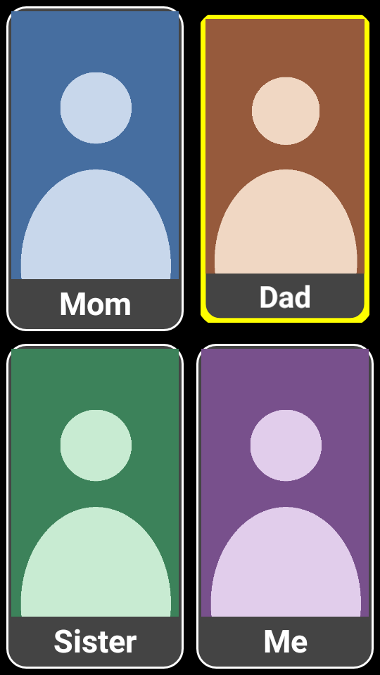

# Grandma Call

**Turn an old Android phone into a one-tap calling screen for a grandparent who doesn't
read or isn't comfortable with technology.**

The phone shows only big photos of family members. Tap a photo and the call starts at once,
on loudspeaker. When the call ends, the photos come back. Nothing else on the phone can be
reached by accident. The phone sits on a stand, plugged in, always on.



It was built for my grandmother, on an old Samsung Galaxy J2 from 2015 that was lying in
a drawer. If someone in your family lives alone and finds smartphones confusing, this might
help them too.

---

## What it does

- **One tap = one call.** A photo calls when touched, even if the finger slides, is held
  or lands in the gap between photos. Shaky double taps can't start two calls.
- **Loudspeaker on by itself,** and ring and call volume at maximum.
- **Back to the photos after every call,** reboot and power cut. It's the phone's home
  screen.
- **No way out by accident.**
  - Back, Recents and volume do nothing.
  - The notification shade is blocked, and the power menu (with Airplane mode) closes
    instantly.
  - Any other screen bounces back to the photos.
- **Always on.** It dims after a minute and brightens on touch. A power-button press
  turns the screen straight back on. The picture shifts a few pixels now and then
  against burn-in.
- **Outage mode.** On a power cut, the screen may sleep to stretch the battery. Calls
  still work. The family gets an SMS for "power cut", "battery low" and "power is back".
- **Ways in for the family.**
  - Hold the top-left corner for 5 s → family menu (settings, normal phone).
  - Press Back 5 times quickly → normal phone for 10 minutes, for a visitor or an
    emergency.
- **No internet, no accounts, no tracking.** Everything stays on the phone.

---

## Supported phones

| | |
|---|---|
| **Tested** | Samsung Galaxy J2 (SM-J200G), Android 5.1.1 |
| **Should work** | Android 5.1 – 13 phones. Samsung and stock Android are the best bets. |
| **Won't install** | Android 14 and newer. The app targets Android 5.1 so it needs no permission prompts, and Android 14 refuses such apps. Modern-Android support is on the roadmap. |
| **iPhone** | Use Apple's built-in **Assistive Access** instead (see below). |

You'll also need:
- **A SIM card** with an active plan. Prepaid plans expire, and an expired SIM fails
  silently.
- **A charger** and a stand.
- **A computer** (macOS, Linux or Windows) for the one-time setup.

---

## Set it up

### 1. On your computer

Install:
- `adb` (Android platform tools);
- JDK 17;
- the Android SDK (Android Studio's SDK manager, or the command-line tools).

On macOS:

```bash
brew install android-platform-tools openjdk@17
brew install --cask android-commandlinetools
```

Then:

```bash
git clone https://github.com/Vrund09/grandma-call-kiosk.git
cd grandma-call-kiosk
echo "sdk.dir=$HOME/Library/Android/sdk" > local.properties   # path to your Android SDK
```

### 2. Add your family

```bash
cp config.example.json config.json
```

Put photos in `photos/` (portrait, face in the middle) and edit `config.json`:

```json
{ "name": "Mom", "number": "+919800000000", "photo": "photos/mom.jpg" }
```

- Use full international numbers (`+91…`).
- 1–3 people each get a full-width row. 4 or more go two per row.
- Set `"dryRun": false` when you're ready for real calls. The example config starts in dry
  run, so a test build never phones anyone.
- `config.json` and `photos/` are git-ignored. Your family's data never goes into git.

### 3. Prepare the phone

1. **Factory reset** it. Settings → Backup and reset → Factory data reset.
2. During setup: **skip Wi-Fi, skip every Google/Samsung account, no screen lock.** The
   kiosk lock (Android "device owner") can only be set on a phone with no accounts.
3. Turn on **USB debugging**:
   - Settings → About phone → tap **Build number** 7 times.
   - Developer options → USB debugging on.
4. Plug it into the computer and accept the "Allow USB debugging?" prompt.

### 4. Install

```bash
./scripts/setup-new-phone.sh
```

This script:
- creates your signing key (`keystore/release.keystore`, git-ignored — **back it up**);
- builds and installs the app;
- makes it device owner;
- applies the always-on settings;
- reboots.

The phone comes up on the photos.

> **Why back up the key?** A device-owner app can't be uninstalled, and Android only
> installs updates signed with the same key. Lose it and the only way to update is another
> factory reset.

### 5. Test before you leave

- Tap every photo with someone ready to answer. Check the speaker comes on and the photos
  come back after hang-up.
- Press Back, Home, Recents and the volume keys, and pull down from the top. You should
  always end up on the photos.
- Unplug the charger. With `alertNumber` set, you get an SMS after 2 minutes.

### Changing photos or numbers later

Edit `config.json` or `photos/`, plug the phone in, and run:

```bash
./scripts/install.sh
```

---

## Configuration

| Key | What it does |
|---|---|
| `contacts` | `name`, `number`, `photo` for each person |
| `speakerphone` | Loudspeaker during calls (default `true`) |
| `blockStatusBar` | Block the notification shade (default `true`) |
| `dryRun` | `true` = taps and alert SMS are only logged (`adb logcat \| grep GrandmaCall`), nothing is dialled or sent |
| `alertNumber` | Who gets the power-cut / low-battery / power-back SMS. Empty = no alerts. |
| `powerCutAlertSeconds` | How long the power must be off before the first SMS (default 120) |
| `hideApps` | Package names to hide (they stop running and use no memory). The example list is for a Samsung; list yours with `adb shell pm list packages`. Never hide the phone, dialler, contacts, settings or keyboard apps. |

---

## For the family

| Situation | What to do |
|---|---|
| A visitor needs the normal phone | Press **Back 5 times quickly**. You get the normal home screen for 10 minutes. |
| Need Settings, Wi-Fi, or to power off | Hold the **top-left corner** for 5 s → family menu. The locks relax for 10 minutes. |
| Turn it back into a normal phone | Family menu → **Normal phone**. Hidden apps come back and the home screen is released. |
| Phone is off / battery went flat | Plug in, hold **Power** ~3 s. It starts into the photos. |
| Frozen | Hold **Power + Volume down** ~10 s. |
| Start over completely | Power off, then hold **Volume up + Home + Power** → *Wipe data/factory reset*. |

---

## Things to know

- **It is not an emergency device.**
  - Grandma Call depends on the phone, the SIM, the network and power.
  - Test it regularly and keep the SIM recharged.
  - Don't rely on it as anyone's only way to get help.
- **Battery.** A phone charging 24/7 for years can swell. Use a plain 5 V charger, keep it
  cool, and check the back for bulging every month or two.
- **Long power cuts.** Outage mode stretches the battery to days. If it still runs flat,
  most Samsungs won't switch themselves back on, and someone has to hold Power. A small
  5 V USB mini UPS (sold for Wi-Fi routers) avoids this.
- **Prepaid SIMs.** When validity expires, the operator bars outgoing calls and replies by
  SMS. Calls just fail.
- **Loudspeaker.** On Android 5.x an app can't be the phone's dialler, so the app asks
  for speaker when placing the call and keeps re-asserting it.

### What we learned on a real phone

These went wrong first and are handled now:
- A Samsung diagnostics app crashed once a SIM was inserted. Its error box covered the
  screen and swallowed taps, so it's hidden.
- SMS quick-reply pop-ups covered the photos, so heads-up notifications are turned off.
- Android reports "idle" as soon as an app starts listening to the call state. Taken as a
  hang-up, that cancelled calls.
- The escape guards fought the call screen. They now pause while a call is starting.

---

## iPhone?

iOS doesn't let an app start a call without a confirmation, replace the home screen, or
block the Home gesture, so this app can't exist on iPhone. Apple's **Assistive Access**
(iOS 17+, Settings → Accessibility → Assistive Access) does much the same: a locked-down
mode with a big-button Calls app showing chosen contacts with photos.

---

## How it's built

Plain Android Views in Kotlin, no libraries, one small APK.

| File | Role |
|---|---|
| `MainActivity.kt` | Photo grid, tap handling, dimming, burn-in shift, escape guards, family gestures |
| `CallService.kt` | Dialling, volume, loudspeaker, return to photos |
| `KeepOnService.kt` | Screen stays on; outage mode and SMS alerts |
| `Kiosk.kt` | Device-owner powers: home pinning, hiding apps, guard timing |
| `AdminActivity.kt` | Hidden family menu |
| `StatusBarBlocker.kt` | Invisible strip that stops the notification shade |
| `Config.kt` | Reads `config.json` |

Design choices and why:
- **A home launcher**, so Android always comes back to it.
- **Device owner**, to pin itself and hide apps.
- **Not Android's single-app mode (LockTask),** because on 5.x it can block the call
  screen.
- **`targetSdk 22`,** so it needs no permission prompts.

---

## Roadmap

Ideas, roughly in order. Contributions welcome.

- [ ] **Modern Android (6–15).**
  - Become the default dialler for proper speaker and call control.
  - Single-app mode with the call screen allowed.
  - Runtime permissions.
- [ ] **QR-code setup.** Provision device owner during first-time setup, no computer needed.
- [ ] **In-app editor.** The family picks photos and numbers from the family menu, no JSON.
- [ ] **Incoming calls.** One-touch answer, or auto-answer from the family's numbers.
- [ ] **Daily "I'm OK" SMS** to the family.
- [ ] **Translations** and right-to-left layouts.
- [ ] **Testing on more phones** (Xiaomi, Oppo and others with aggressive battery savers).

## Contributing

Issues and pull requests are welcome, especially reports of which phones it works on.
Please don't include anyone's real photos or numbers in issues or PRs.

## License

[MIT](LICENSE)
